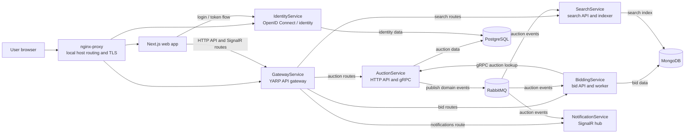
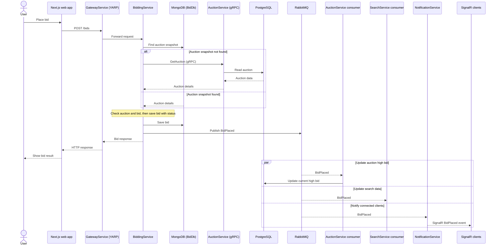

# Carsties Solution Architecture

## Overview

Carsties is a containerized auction marketplace composed of a Next.js web application and independently hosted ASP.NET Core services. The web app reaches backend HTTP endpoints through a YARP API gateway. Services use PostgreSQL or MongoDB for persistence, RabbitMQ for asynchronous messaging, and gRPC for the bidding service's synchronous auction lookup. Identity is provided by the IdentityService.

## High-level component view

In the local Compose environment, nginx-proxy routes configured hostnames to the web app, gateway, and identity service. The gateway's YARP configuration maps auction, bid, search, and notification paths to their respective services. The web app also connects to the notification hub for real-time updates.

## Service responsibilities

| Component | Responsibility | Main integrations |
|---|---|---|
| `src/frontend/web-app` | User-facing auction marketplace | Gateway API, IdentityService, SignalR notifications |
| `src/GatewayService` | Reverse-proxy API entry point and configured route policies | AuctionService, BiddingService, SearchService, NotificationService |
| `src/IdentityService` | User identity and token issuance | PostgreSQL |
| `src/AuctionService` | Auction HTTP API, persistence, and gRPC auction lookup | PostgreSQL, RabbitMQ |
| `src/BiddingService` | Bid API, auction event handling, and finished-auction checks | MongoDB, RabbitMQ, AuctionService gRPC |
| `src/SearchService` | Search API and event-driven search index updates | MongoDB, RabbitMQ, AuctionService HTTP client |
| `src/NotificationService` | SignalR hub and event-triggered client notifications | RabbitMQ |
| `src/Contracts` | Shared message types for service communication | Referenced by event publishers and consumers |

## Key interaction flows

### User API requests

1. The browser sends an API request to the configured API host.
2. nginx-proxy forwards it to GatewayService.
3. YARP forwards auction, bid, and search routes to their owning services; notification connections are routed to NotificationService.
4. IdentityService is the configured token authority for the gateway and backend services. The YARP configuration assigns an authorization policy to auction-write and bid-write routes; each service also owns its endpoint authorization behavior.

### Bidding and auction lookup

The browser submits a bid through the gateway to BiddingService. The bidding service uses gRPC to query AuctionService for auction details and persists bid data in MongoDB. Auction state is stored by AuctionService in PostgreSQL. The web app connects to the notification hub through the gateway's notifications route.

#### Bid submission sequence

The RabbitMQ consumers process `BidPlaced` asynchronously; the HTTP response does not wait for those downstream updates. The web app establishes its SignalR connection through the gateway's notifications route.

### Event-driven updates

Services share message contracts from `Contracts` and communicate asynchronously through RabbitMQ. Auction events are consumed by downstream services: SearchService updates its MongoDB search index, BiddingService handles auction lifecycle events, and NotificationService can broadcast auction-created updates to connected SignalR clients. AuctionService configures an Entity Framework outbox backed by its database.

## Runtime and local development

The local dependencies and service containers are defined in [`docker-compose.yml`](../docker-compose.yml). The .NET services and solution are under `src/` and `Carsties.sln`; frontend scripts are in `src/frontend/web-app/package.json`. See [`ONBOARDING.md`](../ONBOARDING.md) for a getting-started workflow.

Configuration is supplied through each service's `appsettings*.json` files and Compose environment variables. Keep credentials and environment-specific secrets out of committed documentation and source files.
